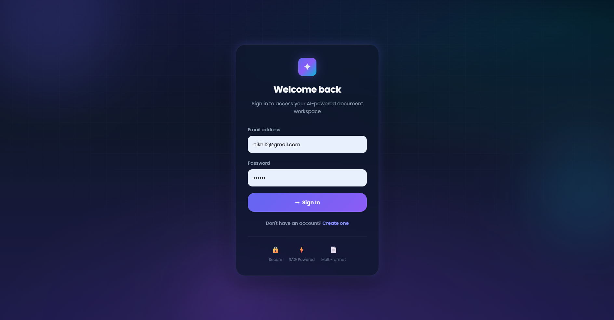
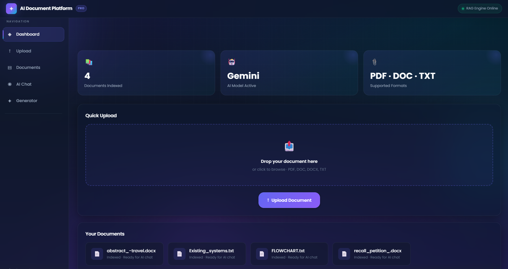
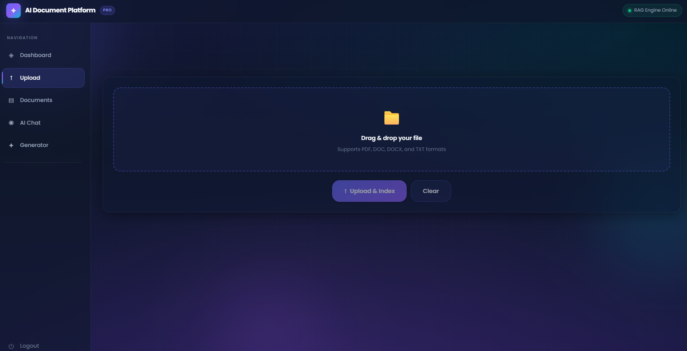
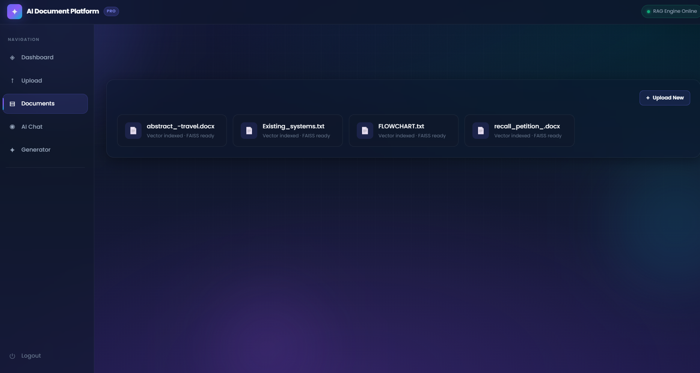
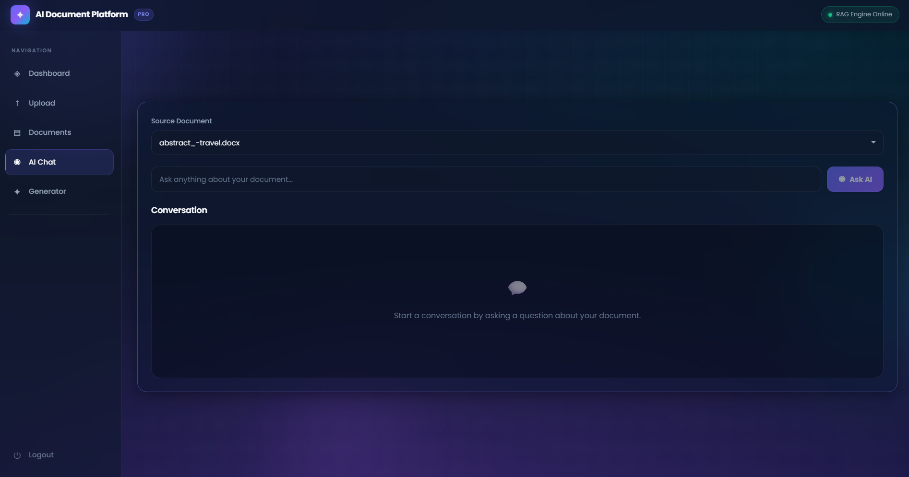
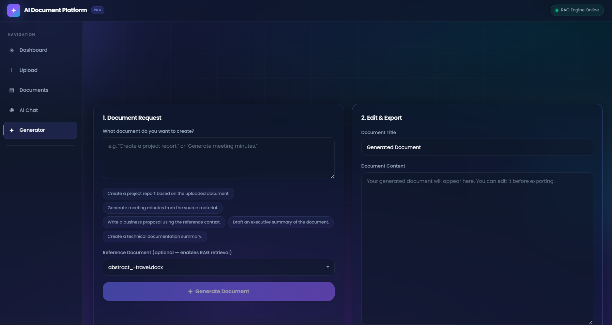

<!-- ========================================================= -->

<!--                    AI DOCUMENT PLATFORM                    -->

<!-- ======================= PART 1 =========================== -->

<!-- ========================================================= -->

<h1 align="center">
🤖 AI Document Generation Platform
</h1>

<p align="center">
AI-powered Full-Stack Document Intelligence Platform using React, Flask, Google Gemini & Retrieval-Augmented Generation (RAG)
</p>

<p align="center">


</p>

---

# 📖 Overview

The **AI Document Generation Platform** is a modern **full-stack AI application** that enables users to upload documents, interact with them using an intelligent AI assistant, generate professional documents from natural language prompts, and export the results in **PDF** or **Microsoft Word (DOCX)** format.

Unlike traditional AI chat applications, this platform leverages **Retrieval-Augmented Generation (RAG)** to retrieve the most relevant information from uploaded documents before generating responses. This significantly improves answer quality, minimizes hallucinations, and ensures responses remain grounded in the user's own documents.

The project demonstrates practical implementation of **Large Language Models (LLMs)** within a production-style web application using **Google Gemini AI**, **FAISS Vector Search**, **React**, **Flask**, and **SQLite**.

---

# ✨ Key Features

## 🔐 User Authentication

* Secure user registration
* User login
* Session management
* Protected routes

---

## 📂 Document Management

* Upload PDF documents
* Upload DOCX documents
* Upload TXT documents
* Document dashboard
* Manage uploaded files

---

## 💬 AI Document Chat

Chat directly with uploaded documents using AI.

### Features

* Google Gemini integration
* Context-aware responses
* Retrieval-Augmented Generation (RAG)
* Retrieved context visualization
* Intelligent document understanding

---

## 📝 AI Document Generator

Generate complete professional documents from natural language prompts.

Supported document types include:

* Project Reports
* Meeting Minutes
* Technical Documentation
* Research Summaries
* Business Reports
* Legal Drafts
* Custom Documents

### Generator Features

* Prompt-based generation
* Optional reference document
* RAG-powered document retrieval
* Editable generated content
* Live word count
* Quick prompt suggestions
* Professional formatting

---

## 📄 Export Documents

Generated content can be exported as:

* PDF (ReportLab)
* DOCX (python-docx)

Supports:

* Markdown headings
* Professional formatting
* Download-ready documents

---

# 🧠 Why Retrieval-Augmented Generation (RAG)?

Traditional AI models generate responses solely from their training data, which can sometimes produce inaccurate or fabricated information.

This project solves that limitation by implementing **Retrieval-Augmented Generation (RAG)**.

### RAG Workflow

1. User uploads a document.
2. The document is processed and divided into chunks.
3. FAISS indexes the chunks for efficient semantic retrieval.
4. The most relevant chunks are retrieved for each user query.
5. Google Gemini receives both the prompt and retrieved context.
6. Gemini generates a response grounded in the uploaded document.

### Benefits

* More accurate responses
* Reduced hallucinations
* Faster information retrieval
* Context-aware document generation

---

# 🏗 System Architecture

```text
                             React + Vite Frontend
                                      │
      ┌───────────────────────────────┼──────────────────────────────┐
      │                               │                              │
 Authentication                  AI Chat                 AI Document Generator
      │                               │                              │
      └───────────────────────────────┴──────────────────────────────┘
                                      │
                               Flask REST API
                                      │
      ┌───────────────┬───────────────┼───────────────┬────────────────┐
      │               │               │               │
 Authentication   Document Upload   RAG Engine   Export Service
      │               │               │               │
      │        Text Extraction        │        PDF / DOCX Export
      │               │               │               │
      │         Chunking + FAISS      │     ReportLab / python-docx
      └───────────────┴───────────────┴───────────────────────────────┘
                                      │
                              Google Gemini API
                                      │
                      AI Chat & Document Generation
                                      │
                              SQLite Database
```

---

# 🔄 AI Workflow

```text
                 User Uploads Document
                         │
                         ▼
              Document Text Extraction
                         │
                         ▼
               Chunking & FAISS Indexing
                         │
                         ▼
                User Enters Prompt
                         │
                         ▼
           Retrieve Relevant Document Chunks
                         │
                         ▼
                  Google Gemini AI
                         │
                         ▼
          AI Response / Generated Document
                         │
                         ▼
              User Reviews & Edits Content
                         │
                         ▼
               Export as PDF or DOCX
```

---

# 🎯 Project Highlights

* 🤖 Google Gemini AI Integration
* 🧠 Retrieval-Augmented Generation (RAG)
* 📄 AI Document Generation
* 💬 Intelligent Document Chat
* 🔍 FAISS Semantic Search
* 📤 PDF Export
* 📘 DOCX Export
* ⚛️ React Frontend
* 🐍 Flask Backend
* 💾 SQLite Database
* 📱 Responsive User Interface
* 🏗 Modular Full-Stack Architecture

---

---

# 🎥 Project Demonstration

> **📹 Demo Video:** *(Add your YouTube or Google Drive link here)*

```
https://your-demo-link-here.com
```

The demonstration showcases:

* User Registration & Login
* Document Upload
* AI Document Chat
* AI Document Generation
* Retrieval-Augmented Generation (RAG)
* PDF Export
* DOCX Export

---

# 📸 Application Screenshots

## 🔐 Login Page



---

## 📊 Dashboard



---

## 📤 Upload Documents



---

## 📁 My Documents



---

## 💬 AI Document Chat



---

## 🤖 AI Document Generator



---

# 🛠 Technology Stack

## Frontend

| Technology   | Purpose             |
| ------------ | ------------------- |
| React.js     | User Interface      |
| Vite         | Frontend Build Tool |
| React Router | Client-side Routing |
| CSS3         | Styling             |
| JavaScript   | Frontend Logic      |

---

## Backend

| Technology | Purpose              |
| ---------- | -------------------- |
| Python     | Backend Language     |
| Flask      | REST API Framework   |
| Flask-CORS | Cross-Origin Support |
| SQLAlchemy | ORM                  |
| SQLite     | Database             |

---

## Artificial Intelligence

| Technology                           | Purpose                     |
| ------------------------------------ | --------------------------- |
| Google Gemini API                    | Large Language Model        |
| Retrieval-Augmented Generation (RAG) | Context-Aware Responses     |
| FAISS                                | Semantic Similarity Search  |
| Document Chunking                    | Efficient Context Retrieval |

---

## Document Processing

| Technology  | Purpose               |
| ----------- | --------------------- |
| ReportLab   | PDF Generation        |
| python-docx | Microsoft Word Export |

---

# 📂 Project Structure

```text
AI-Document-Platform/
│
├── backend/
│   ├── app.py
│   ├── models.py
│   ├── gemini_service.py
│   ├── document_processor.py
│   ├── document_exporter.py
│   ├── requirements.txt
│   └── instance/
│
├── frontend/
│   ├── src/
│   │   ├── components/
│   │   ├── pages/
│   │   ├── assets/
│   │   └── styles/
│   │
│   ├── public/
│   ├── package.json
│   └── vite.config.js
│
├── screenshots/
│
├── README.md
└── .gitignore
```

---

# ⚙️ Installation Guide

## Clone the Repository

```bash
git clone https://github.com/nx997k/AI-Document-Platform.git
```

---

## Backend Setup

```bash
cd backend

pip install -r requirements.txt

python app.py
```

Backend runs on:

```
http://localhost:5000
```

---

## Frontend Setup

```bash
cd frontend

npm install

npm run dev
```

Frontend runs on:

```
http://localhost:5173
```

---

# 🚀 How to Use

### Step 1

Register a new account or log in.

---

### Step 2

Upload one or more PDF, DOCX or TXT files.

---

### Step 3

Navigate to **AI Chat**.

Ask questions regarding the uploaded document.

Example:

```
Summarize this document.

Explain the methodology.

List the key findings.
```

---

### Step 4

Open **AI Document Generator**.

Example prompts:

```
Generate a Project Report.

Create Meeting Minutes.

Generate Technical Documentation.

Write a Business Proposal.
```

---

### Step 5

Select an optional reference document for Retrieval-Augmented Generation (RAG).

---

### Step 6

Generate the document.

---

### Step 7

Edit the generated content directly inside the editor.

---

### Step 8

Export the final document as:

* PDF
* DOCX

---

# 💡 Example Workflow

```
User Login
      │
      ▼
Upload Document
      │
      ▼
AI Chat
      │
      ▼
AI Document Generator
      │
      ▼
Review Generated Content
      │
      ▼
Export PDF / DOCX
```

---

# ⚡ Performance Optimizations

✔ Retrieval-Augmented Generation (RAG)

✔ FAISS Semantic Search

✔ Context Chunking

✔ Modular Flask REST APIs

✔ Optimized React Components

✔ Fast PDF & DOCX Export

✔ Responsive User Interface

✔ Lightweight SQLite Database

---
---

# 📡 REST API

## Authentication

| Method | Endpoint    | Description         |
| ------ | ----------- | ------------------- |
| POST   | `/register` | Register a new user |
| POST   | `/login`    | Authenticate user   |

---

## Document Management

| Method | Endpoint     | Description                 |
| ------ | ------------ | --------------------------- |
| POST   | `/upload`    | Upload a document           |
| GET    | `/documents` | Retrieve uploaded documents |

---

## AI Features

| Method | Endpoint    | Description                             |
| ------ | ----------- | --------------------------------------- |
| POST   | `/chat`     | Chat with uploaded documents            |
| POST   | `/generate` | Generate AI-powered documents           |
| POST   | `/export`   | Export generated content as PDF or DOCX |

---

# 🧩 Technical Challenges & Solutions

| Challenge                    | Solution                                                                                |
| ---------------------------- | --------------------------------------------------------------------------------------- |
| AI hallucinations            | Implemented Retrieval-Augmented Generation (RAG)                                        |
| Large document processing    | Chunked documents into smaller semantic sections                                        |
| Fast similarity search       | Integrated FAISS vector indexing                                                        |
| Context-aware responses      | Retrieved relevant document chunks before prompting Gemini                              |
| Professional document export | Used ReportLab for PDF and python-docx for DOCX generation                              |
| Modular architecture         | Separated frontend, backend, AI services, and document processing into reusable modules |

---

# ⚡ Performance Optimizations

* Implemented Retrieval-Augmented Generation (RAG) to improve AI response quality.
* Used FAISS vector search for efficient semantic retrieval.
* Chunked large documents for better context management.
* Modular Flask REST APIs for maintainability.
* Responsive React frontend with optimized components.
* Efficient PDF and DOCX generation.
* Lightweight SQLite database for local development.

---

# 🚀 Future Enhancements

* 🔍 OCR support for scanned PDFs
* ☁️ Cloud storage integration
* 🌍 Multi-language document generation
* 🎙️ Voice-based AI interaction
* 👥 Team collaboration workspaces
* 🔐 JWT-based authentication
* 🐳 Docker deployment
* ⚙️ CI/CD pipeline
* ☁️ AWS / Azure deployment
* 📊 Analytics dashboard
* 📱 Mobile-responsive enhancements

---

# 📚 Key Learning Outcomes

Through this project, I gained practical experience in:

* Full-Stack Web Development
* REST API Design
* AI Application Development
* Retrieval-Augmented Generation (RAG)
* Google Gemini API Integration
* Vector Search using FAISS
* PDF & DOCX document generation
* Database management with SQLite
* Modular software architecture
* Modern React application development

---

# 🤝 Contributing

Contributions are welcome!

If you'd like to improve the project:

1. Fork the repository.
2. Create a new feature branch.
3. Commit your changes.
4. Push your branch.
5. Open a Pull Request.

---

# 📄 License

This project is licensed under the **MIT License**.

You are free to use, modify, and distribute this project under the terms of the MIT License.

---

# 👨‍💻 Author

## Nikhil Mettu

**B.Tech – Artificial Intelligence & Data Science**

* GitHub: https://github.com/nx997k

---

# 🙏 Acknowledgements

Special thanks to the open-source community and the technologies that made this project possible:

* React.js
* Flask
* Google Gemini API
* FAISS
* SQLAlchemy
* ReportLab
* python-docx
* Vite

---

# ⭐ Support

If you found this project helpful or interesting, consider giving it a **⭐ Star** on GitHub.

It helps increase the visibility of the project and motivates further development.

---

<p align="center">

### Thank you for visiting this repository! 🚀

Built with  using **React**, **Flask**, **Google Gemini**, and **Retrieval-Augmented Generation (RAG)**.

</p>
